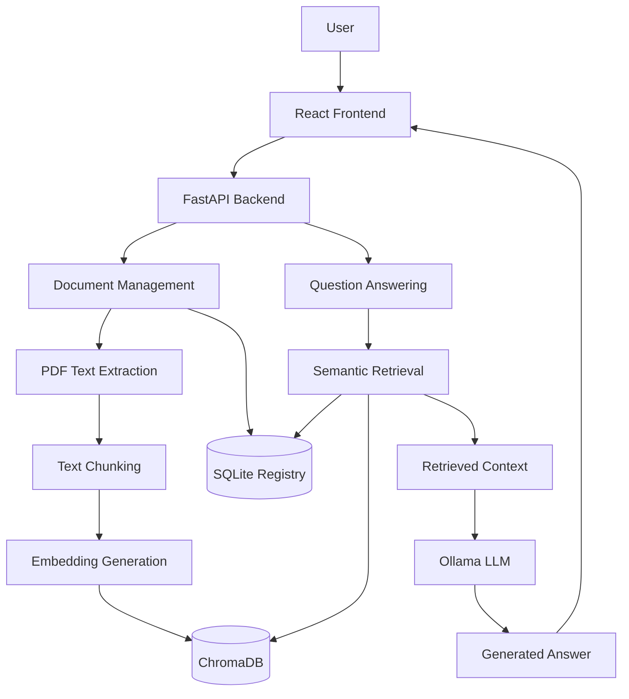

# Intelligent Document Assistant

### An AI-powered document intelligence system built with Retrieval-Augmented Generation (RAG).

---

## Overview

**Intelligent Document Assistant** is a full-stack AI application that enables users to upload documents and interact with their contents through natural-language queries.

The system implements a Retrieval-Augmented Generation (RAG) architecture to extract document content, divide it into meaningful chunks, generate semantic embeddings, and retrieve relevant information before passing the context to a Large Language Model (LLM).

Instead of relying entirely on an LLM's pre-trained knowledge, the application grounds its responses in information retrieved from the uploaded documents.

The project focuses on building a modular, testable document-processing and retrieval pipeline using open-source technologies and locally hosted language models.

## Features

### Document Management
- Upload and manage PDF documents.
- Validate uploaded files before processing.
- Maintain document records using SQLite.
- Support document listing and deletion.
- Track document metadata throughout the ingestion pipeline.

### Document Processing
- Extract text from PDF documents.
- Process extracted content through a structured ingestion pipeline.
- Split documents into manageable, overlapping text chunks.
- Preserve relevant metadata for downstream retrieval.
- Generate embeddings for semantic representation.

### Semantic Retrieval
- Generate vector embeddings using Sentence Transformers.
- Store document embeddings in persistent ChromaDB storage.
- Perform semantic similarity-based retrieval.
- Retrieve relevant document passages for user queries.
- Maintain document-level relationships between stored content and metadata.

### Retrieval-Augmented Generation
- Integrate semantic retrieval with LLM-based answer generation.
- Use retrieved document context to construct responses.
- Run language models locally through Ollama.
- Configure retrieval parameters and generation temperature.

### Web Interface
- Modern React and TypeScript frontend.
- Document management interface.
- Interactive document question-answering experience.
- Light and dark themes.
- Responsive and visually polished interface.

### Engineering and Deployment
- Modular FastAPI backend architecture.
- RESTful API endpoints.
- SQLite metadata persistence.
- Persistent vector storage.
- Automated backend testing with Pytest.
- Multi-stage Docker image build.
- Docker Compose deployment.

---

## Architecture

The application follows a modular Retrieval-Augmented Generation architecture.

### System Architecture



### RAG Pipeline

The document ingestion and question-answering workflows are separated into distinct stages.

**1. Document Ingestion**

```text
PDF Upload
    |
    v
File Validation
    |
    v
Text Extraction
    |
    v
Text Chunking
    |
    v
Embedding Generation
    |
    v
ChromaDB Storage
    |
    v
SQLite Document Registry
```

**2. Question Answering**

```text
User Question
    |
    v
Query Embedding
    |
    v
Semantic Retrieval
    |
    v
Relevant Context
    |
    v
Prompt Construction
    |
    v
Ollama LLM
    |
    v
Generated Response
```

---

## Technology Stack

| Component | Technology |
|---|---|
| Programming Language | Python 3.12 |
| Backend Framework | FastAPI |
| Frontend Framework | React 19 |
| Frontend Language | TypeScript |
| Frontend Build Tool | Vite |
| API Server | Uvicorn |
| Document Processing | PyMuPDF |
| Document Processing Framework | Docling |
| AI Framework | LangChain |
| Embedding Model | Sentence Transformers |
| Vector Database | ChromaDB |
| Metadata Database | SQLite |
| Local LLM Runtime | Ollama |
| Default LLM | Gemma 3 (4B) |
| Testing | Pytest |
| Containerization | Docker |
| Container Orchestration | Docker Compose |

---

## Project Structure

```text
intelligent-document-assistant/
│
├── backend/
│   ├── app/
│   │   ├── api/
│   │   │   ├── documents.py
│   │   │   └── questions.py
│   │   │
│   │   ├── core/
│   │   │   └── database.py
│   │   │
│   │   ├── services/
│   │   │   ├── document_loader.py
│   │   │   ├── chunking.py
│   │   │   ├── embedding.py
│   │   │   ├── vector_store.py
│   │   │   ├── document_registry.py
│   │   │   ├── retrieval_service.py
│   │   │   └── rag_service.py
│   │   │
│   │   ├── config.py
│   │   └── main.py
│   │
│   ├── tests/
│   └── requirements.txt
│
├── frontend/
│   ├── src/
│   │   ├── components/
│   │   ├── services/
│   │   ├── App.tsx
│   │   └── ...
│   │
│   └── package.json
│
├── data/
│   ├── uploads/
│   ├── chroma_db/
│   └── documents.db
│
├── Dockerfile
├── docker-compose.yml
├── .dockerignore
├── .gitignore
└── README.md
```

*Note: The structure above represents the major architectural components. Individual filenames may evolve as the project develops.*

---

## Getting Started

### Prerequisites

Make sure you have the following installed:

- Python 3.12+
- Node.js 22+
- npm
- Git
- Ollama
- Docker Desktop (for containerized deployment)

### 1. Clone the Repository

```bash
git clone https://github.com/techinbuddy09/Intelligent_Doc_Assistant.git

cd Intelligent_Doc_Assistant
```

### 2. Set Up Ollama

Install Ollama from:

https://ollama.com/download

Pull the default language model:

```bash
ollama pull gemma3:4b
```

Ensure Ollama is running before starting the application.

### 3. Configure the Backend

Create and activate a Python virtual environment:

**Windows (PowerShell)**

```powershell
python -m venv venv

.\venv\Scripts\Activate.ps1
```

**Linux / macOS**

```bash
python -m venv venv

source venv/bin/activate
```

Install backend dependencies:

```bash
pip install -r backend/requirements.txt
```

### 4. Start the Backend

```bash
cd backend

uvicorn app.main:app --reload --port 8000
```

The backend will be available at:

http://localhost:8000

Interactive API documentation:

http://localhost:8000/docs

### 5. Start the Frontend

Open a separate terminal:

```bash
cd frontend

npm install

npm run dev
```

The frontend will be available at:

http://localhost:5173

---

## Docker Deployment

The project includes a multi-stage Docker build that compiles the React frontend and packages the FastAPI backend into a single application image.

### 1. Build and Start

From the project root:

```bash
docker compose up --build -d
```

### 2. Access the Application

| Service | URL |
|---|---|
| Web Application | http://localhost:8000 |
| FastAPI Backend | http://localhost:8000 |
| API Documentation | http://localhost:8000/docs |
| Health Check | http://localhost:8000/health |

### 3. View Container Logs

```bash
docker compose logs -f
```

### 4. Stop the Application

```bash
docker compose down
```

### 5. Persistent Data

Docker Compose uses a named volume to preserve application data:

- Uploaded documents.
- ChromaDB vector database.
- SQLite document registry.

**Important:** Ollama runs separately from the application container. The Docker configuration connects to Ollama running on the host machine through `host.docker.internal`.

Make sure Ollama is running and the configured model is available before using the application.

---

## Testing

The backend includes an automated test suite built with Pytest.

Run the complete test suite from the project root:

```bash
pytest backend/tests -v
```

The tests cover core backend functionality, including:

- Configuration and initialization.
- Document validation and processing.
- Text extraction.
- Document chunking.
- Embedding generation.
- Vector storage.
- Document registry operations.
- Semantic retrieval.
- RAG service integration.
- API functionality.

The project has successfully passed **240 automated tests** during development.

---

## Engineering Approach

The project was developed using an incremental engineering approach.

Rather than implementing the entire RAG architecture at once, individual components were developed, tested and integrated progressively.

Key engineering priorities include:

- Separation of concerns between document processing, storage, retrieval and generation.
- Persistent document and vector storage.
- Reusable service components.
- Configuration-driven application behavior.
- Automated testing at component and integration levels.
- Reproducible deployment using Docker.

A central design consideration is that **retrieval quality directly affects answer quality**. A language model cannot consistently produce accurate document-grounded answers if the retrieval system fails to identify the relevant passages.

---

## Current Limitations

This project is actively evolving. Some advanced document intelligence capabilities are not yet implemented.

Current areas for improvement include:

- Improving retrieval relevance for complex queries.
- Hybrid retrieval combining semantic and keyword search.
- Cross-encoder reranking.
- Query rewriting and expansion.
- Better handling of complex document layouts.
- OCR support for scanned documents.
- Improved table and image understanding.
- Retrieval and answer-quality evaluation.
- Conversational memory improvements.

These are identified development areas, not claims of existing functionality.

---

## Roadmap

| Feature | Status |
|---|---|
| FastAPI backend foundation | Completed |
| PDF upload and validation | Completed |
| Document text extraction | Completed |
| Text chunking | Completed |
| Embedding generation | Completed |
| ChromaDB integration | Completed |
| SQLite document registry | Completed |
| Document ingestion integration | Completed |
| Semantic retrieval | Implemented |
| RAG question answering | Implemented |
| React frontend | Completed |
| Docker containerization | Completed |
| Hybrid search | Planned |
| Cross-encoder reranking | Planned |
| Query transformation | Planned |
| Advanced retrieval evaluation | Planned |
| Multimodal document understanding | Planned |

---

## Future Direction

The long-term objective is to evolve this application into a more capable document intelligence system.

Potential extensions include:

1. Advanced hybrid retrieval architectures.
2. Context-aware query transformation.
3. Reranking for improved retrieval precision.
4. Multimodal document processing.
5. Better support for tables, figures and scanned documents.
6. Retrieval evaluation using metrics such as Recall@K and MRR.
7. Improved answer faithfulness and citation evaluation.

The focus will remain on measurable improvements to retrieval quality, document understanding and system reliability.

---

## Author

**Tulika Srivastava**

---

## License

This project is currently available under the repository's licensing terms.

---

**Built with Python, FastAPI, React, ChromaDB and Ollama.**
